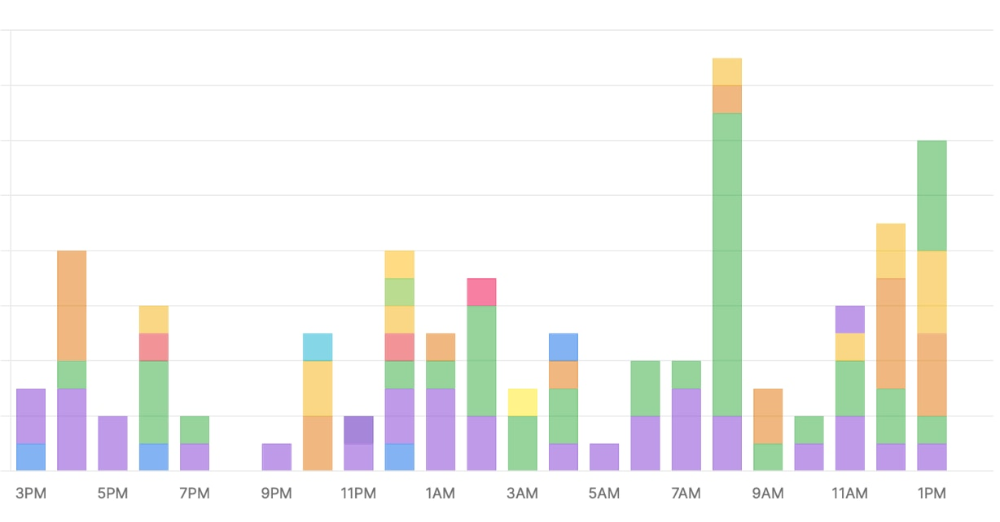

# Umami Analytics Client for Python

[](https://pypi.org/project/umami-analytics/)
[](https://pypi.org/project/umami-analytics/)
[](https://mkennedy.codes/docs/umami-python/)
[](https://github.com/mikeckennedy/umami-python/blob/main/LICENSE)

📚 **Documentation:** [mkennedy.codes/docs/umami-python](https://mkennedy.codes/docs/umami-python/)

Client for privacy-preserving, open source [Umami analytics platform](https://umami.is) based on 
`httpx2` and `pydantic`. 

`umami-analytics` is intended for adding custom data to your Umami instance (self-hosted or SaaS). Many umami events can be supplied directly from HTML via their `data-*` attributes. However, some cannot. For example, if you have an event that is triggered in your app but doesn't have a clear HTML action you can add custom events. These will appear at the bottom of your Umami analytics page for a website.

One example is a **purchase-course** event that happens deep inside the Python code rather than in HTML at [Talk Python Training](https://training.talkpython.fm). This is what our events section looks like for a typical weekend day (US Pacific Time):



## Focused on what you need, not what is offered

The [Umami API is extensive](https://umami.is/docs/api) and much of that is intended for their frontend code to be able to function. You probably don't want or need that. `umami-analytics` only covers the subset that most developers will need for common SaaS actions such as adding [custom events](https://umami.is/docs/event-data). That said, PRs are welcome.

## Core Features

* ➕ **Add a custom event** to your Umami analytics dashboard.
* 💰 **Track revenue** with dedicated revenue event support.
* 📄 **Add a page view** to your Umami analytics dashboard.
* 🆔 **Attach a per-user `distinct_id`** to events, page views, and revenue (sent as the Umami payload `id`).
* 🌐 List all websites with details that you have registered at Umami.
* 📊 **Get website statistics** including page views, visitors, visits, and bounce counts.
* 👥 **Get active users** count for real-time monitoring.
* 💓 **Heartbeat check** to verify Umami server connectivity.
* 🔀 Both **sync** and **async** programming models.
* ⚒️ **Structured data with Pydantic** models for API responses.
* 👩‍💻 **Login** with a username and password against a self-hosted instance of Umami.
* ☁️ **Authenticate against Umami Cloud** with an API key via `set_cloud_api_key()` — no `login()` needed. See [Authentication](https://mkennedy.codes/docs/umami-python/user-guide/authentication.html).
* 🥇Set a **default website** for a **simplified API** going forward.
* 🔧 **Enable/disable tracking** for development and testing environments.

## Development and Testing Support

🔧 **Disable tracking in development**: Use `umami.disable()` to disable all event and page view tracking without changing your code. Perfect for development and testing environments where you don't want to pollute your analytics with test data.

```python
import umami

# Configure as usual
umami.set_url_base("https://umami.hostedbyyouorthem.com")
umami.set_website_id('cc726914-8e68-4d1a-4be0-af4ca8933456')
umami.set_hostname('somedomain.com')

# Disable tracking for development/testing
umami.disable()

# These calls will return immediately without sending data to Umami
umami.new_event('test-event')  # No HTTP request made
umami.new_page_view('Test Page', '/test')  # No HTTP request made

# Re-enable when needed (default state is enabled)
umami.enable()
```

When tracking is disabled:

- ✅ **No HTTP requests** are made to your Umami server by `new_event()`, `new_page_view()`, or `new_revenue_event()`
- ✅ **API calls still validate** parameters (helps catch configuration issues)
- ✅ **All other functions work normally** and still contact the server (login, websites, stats, heartbeat, etc.)
- ✅ **The send functions return `{}`** instead of the server response

The [Testing and CI](https://mkennedy.codes/docs/umami-python/user-guide/testing.html) guide has a pytest fixture for this and shows how to mock the HTTP layer for the query functions.

## Async or sync API? You choose

🔀 **Async is supported but not required** for your Python code. For functions that access the network, there is a `func()` and `func_async()` variant that works with Python's `async` and `await`.

## Installation

```bash
uv add umami-analytics
# or
pip install umami-analytics
```

The import name is `umami`. Do not `pip install umami`; that is an unrelated package. Python 3.10+ is required.

## 📚 Documentation

Full documentation lives at **[mkennedy.codes/docs/umami-python](https://mkennedy.codes/docs/umami-python/)**. The user guide walks through the library in order, and the [API reference](https://mkennedy.codes/docs/umami-python/reference/) covers every public function with its sync and async twin.

- [Getting started](https://mkennedy.codes/docs/umami-python/user-guide/getting-started.html): install, configure, send your first event, and find it in the dashboard.
- [Sending events](https://mkennedy.codes/docs/umami-python/user-guide/sending-events.html): custom events, page views, revenue, and `distinct_id`.
- [Authentication](https://mkennedy.codes/docs/umami-python/user-guide/authentication.html): self-hosted login versus an Umami Cloud API key.
- [Querying stats](https://mkennedy.codes/docs/umami-python/user-guide/querying-stats.html): websites, stats for a date range, active users.
- [Troubleshooting](https://mkennedy.codes/docs/umami-python/user-guide/troubleshooting.html): what each error means, and what to do when an event is sent but never appears.
- [Testing and CI](https://mkennedy.codes/docs/umami-python/user-guide/testing.html): keep test runs out of your real analytics.
- [Configuration](https://mkennedy.codes/docs/umami-python/user-guide/configuration.html), [How it works](https://mkennedy.codes/docs/umami-python/user-guide/how-it-works.html), and the [FAQ](https://mkennedy.codes/docs/umami-python/user-guide/faq.html).

The quick tour below gets you started. For AI assistants there is an [`llms.txt`](https://mkennedy.codes/docs/umami-python/llms.txt) index, an [`llms-full.txt`](https://mkennedy.codes/docs/umami-python/llms-full.txt) with every docstring and guide page, and an [agent skill](https://mkennedy.codes/docs/umami-python/skills.html).

## Usage

```python

import umami

umami.set_url_base("https://umami.hostedbyyouorthem.com")

# Auth is NOT required to send events, but is for other features.
login = umami.login(username, password)

# Skip the need to pass the target website in subsequent calls.
umami.set_website_id('cc726914-8e68-4d1a-4be0-af4ca8933456')
umami.set_hostname('somedomain.com')

# Optional: Disable tracking for development/testing
# umami.disable()  # Uncomment to disable tracking

# List your websites
websites = umami.websites()

# Create a new event in the events section of the dashboards.
event_resp = umami.new_event(
    website_id='a7cd-5d1a-2b33', # Only send if overriding default above
    event_name='Umami-Test',
    title='Umami-Test', # Defaults to event_name if omitted.
    hostname='somedomain.com', # Only send if overriding default above.
    url='/users/actions',
    custom_data={'client': 'umami-tester-v1'},
    distinct_id='user-123',  # OPTIONAL: stable per-user id, sent as payload id
    referrer='https://some_url')

# Create a new page view in the pages section of the dashboards.
page_view_resp = umami.new_page_view(
    website_id='a7cd-5d1a-2b33', # Only send if overriding default above
    page_title='Umami-Test', # Required: the page title to record.
    hostname='somedomain.com', # Only send if overriding default above.
    url='/users/actions',
    distinct_id='user-123',  # OPTIONAL: stable per-user id, sent as payload id
    referrer='https://some_url')

# Track revenue for a transaction
revenue_resp = umami.new_revenue_event(
    revenue=19.99,  # Monetary amount (required)
    currency='USD',  # ISO 4217 currency code, defaults to 'USD'
    event_name='checkout-cart',  # Defaults to 'revenue' if omitted
    url='/checkout',
    distinct_id='user-123',  # OPTIONAL: stable per-user id, sent as payload id
    custom_data={'product': 'widget', 'quantity': 2})

# Get website statistics for a date range
from datetime import datetime, timedelta

end_date = datetime.now()
start_date = end_date - timedelta(days=7)  # Last 7 days

stats = umami.website_stats(
    start_at=start_date,
    end_at=end_date,
    website_id='a7cd-5d1a-2b33'  # Only send if overriding default above
)
print(f"Page views: {stats.pageviews}")
print(f"Unique visitors: {stats.visitors}")
print(f"Bounces: {stats.bounces}")

# Get current active users count
active_count = umami.active_users(
    website_id='a7cd-5d1a-2b33'  # Only send if overriding default above
)
print(f"Currently active users: {active_count}")

# Check if Umami server is accessible
server_ok = umami.heartbeat()
print(f"Umami server is {'accessible' if server_ok else 'not accessible'}")

# Call after logging in to make sure the auth token is still valid.
umami.verify_token()
```

This code listing is very-very high fidelity pseudo code. If you want an actually executable example, see the [example client](https://github.com/mikeckennedy/umami-python/tree/main/umami/example_client) in the repo. [Sending events](https://mkennedy.codes/docs/umami-python/user-guide/sending-events.html) and [Querying stats](https://mkennedy.codes/docs/umami-python/user-guide/querying-stats.html) explain each call, and [Troubleshooting](https://mkennedy.codes/docs/umami-python/user-guide/troubleshooting.html) covers what to do when a call raises or an event does not show up.

## Umami Cloud

Using [Umami Cloud](https://cloud.umami.is) instead of a self-hosted instance? Authenticate with an **API key** rather than `login()`. Create one in Umami Cloud under **Settings → API keys**.

In Cloud mode you do **not** call `set_url_base()` or `login()` — `set_cloud_api_key()` takes care of both the host routing and the authentication header for you:

```python
import umami
from datetime import datetime, timedelta

# Authenticate with your Cloud API key. region is optional ('us' or 'eu');
# omit it to use the region of the account that owns the key.
umami.set_cloud_api_key("your-cloud-api-key", region="eu")
umami.set_website_id("your-website-id")

# Data/management calls go to https://api.umami.is/v1[/region]/...
# and send the x-umami-api-key header automatically.
active_count = umami.active_users()

end = datetime.now()
stats = umami.website_stats(start_at=end - timedelta(days=7), end_at=end)
print(f"Visitors (last 7 days): {stats.visitors}")

# Events are sent to https://cloud.umami.is/api/send automatically.
umami.new_event(event_name="purchase", url="/checkout", hostname="example.com")

# Return to self-hosted / token behavior at any time:
# umami.clear_cloud_api_key()
```

> **Routing is handled for you:** data and management calls go to `https://api.umami.is/v1` (authenticated with the `x-umami-api-key` header), while events are sent to `https://cloud.umami.is/api/send`. Umami documents a Cloud rate limit of **50 calls / 15 seconds** per API key; the library does not throttle or retry.

The **self-hosted (`login()`) usage shown above is unchanged** — Cloud mode is simply a labeled alternative, and existing code keeps working exactly as before. The two modes are exclusive: `login()` raises `OperationNotAllowedError` while a Cloud key is set, and `clear_cloud_api_key()` switches back. Details in [Authentication](https://mkennedy.codes/docs/umami-python/user-guide/authentication.html).

## Want to contribute?

See the [API documentation](https://umami.is/docs/api) for the remaining endpoints to be added. PRs are welcome. But please open an issue first to see if the proposed feature fits with the direction of this library.

Enjoy.